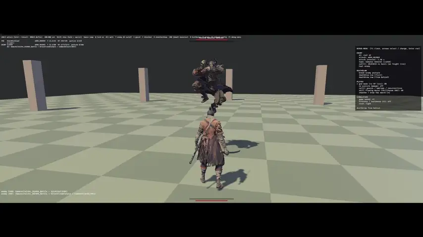

# Sv1

A recreation of SEKIRO: SHADOWS DIE TWICE's combat, written in Rust on
[Bevy](https://bevyengine.org). Every number comes from the game's own files
(animations, params, scripts, models, sounds), not from guessing.



A fan project for study, not affiliated with FromSoftware or Activision. No game
files are in this repository: you need your own copy of the game to build the
data.

## What it does

- **Wolf:** walking, running, sprinting, jumping, steps, lock-on, crouch,
  grappling hook, healing gourd, swimming and diving, falls out of the map (back to safe
  ground for a third of his health), death and resurrection (two nodes, the second locked
  until a deathblow; the game's 死 death screen).
- **Combat:** attacks, guard, deflect, posture, perilous attacks, Mikiri
  Counter, combat arts, prosthetic tools with their status effects, Lightning
  Reversal.
- **Deathblows:** from the front, from behind, stealth and plunging, with the
  game's own camera angles. Bosses kneel at their last mark and the Todome
  finishes them.
- **Enemies:** all 102 kinds the game places, each running its real AI script,
  with stealth (sight, hearing, search). Every main boss with its phases, map
  events and arena, from Genichiro to the Divine Dragon.
- **Looks and sound:** the game's models, cloth, effects, blood, sky, fog,
  lighting, HUD and menus; the game's own sounds and music through FMOD.
- **Skill trees:** find each Esoteric Text to open its school at an idol. On the Construct,
  the five books are at Course Start, Platform Top, Cliff Top, Shaft Floor and the outpost's
  watchtower. Learning still costs skill points and requires the earlier skills.

Values the files don't hold are marked `gap` in the code and in `config.toml`.
Not included: the rest of the game (story, NPCs, saving, open world).

## Controls

The keyboard defaults are Sekiro's own (its `DefaultKeyAssignParam`, each action named by
the game's key guide text). E (talk / wall hug / ledge hang) is reserved for those.

| Action | Keyboard / mouse |
|---|---|
| Move / look | WASD / mouse |
| Walk | Left Alt |
| Attack (hold for the thrust) | Left click or J |
| Guard / deflect | Right click or K |
| Combat art | Left and right click together |
| Step (hold to sprint) | Shift |
| Jump, kick in the air | Space |
| Lock on | Middle mouse button |
| Prosthetic tool | Left Ctrl |
| Switch prosthetic tool | Z |
| Grappling hook | F |
| Use quick item (Healing Gourd, sugars, pellets ...) | R |
| Next quick item | C |
| Menus: OK / back / move | Enter or E / Esc or Q / arrows, mouse wheel; click a row |
| Crouch | Q |
| Swim: fast / dive and sink / rise (diving needs the Mibu Breathing Technique) | hold Shift / Ctrl / F |
| Wall hug / ledge hang / climb up (hold in the air to catch a ledge) | E |
| Wall jump (jump in the air against a wall, or jump while hugging / hanging) | Space |
| Sheathe / draw | X |
| Resurrect / die (when dead) | Left click / right click |

Sandbox keys: `F3` shows the frame rate, `F1` opens the debug menu (enemy, AI mode, skills, tools,
cheats), `T` turns the enemy's AI on or off, `H` shows hurtboxes, `Backspace` resets,
`[` / `]` change the hour, `F5` reloads `config.toml`, `Esc` pauses (the game menu). Click the window to capture the mouse.

## Setup

You need Windows, Sekiro from Steam (patch 1.06), Rust and Python 3
(Node.js optional, for the game's effect files).

1. Build the data from your game (takes a while):
   ```powershell
   powershell -ExecutionPolicy Bypass -File tools\extract.ps1
   ```
   Add `-Sekiro "D:\path\to\Sekiro"` if the game is not in the default Steam
   folder.
2. Run:
   ```bash
   cargo run --release
   ```

Tests: `cargo test --release`.

## Where things are

| Path | What |
|---|---|
| `src/player.rs` | Wolf |
| `src/enemy.rs`, `src/ai.rs` | Enemies and their AI scripts |
| `src/combat.rs` | Hits, posture, damage |
| `src/anim.rs`, `src/model.rs`, `src/cloth.rs` | Animation, models, cloth |
| `src/fxr.rs`, `src/sound.rs`, `src/hud.rs` | Effects, sound, HUD |
| `src/map.rs`, `src/camera.rs` | Maps, camera |
| `tools/sekiro-extract/` | Reads the game's files into `extracted/` |
| `docs/` | Notes on every mechanic and where it was found |

## License

Code under the [MIT License](LICENSE.md). It covers this code only, not the
game or anything generated from it. Please keep `extracted/` out of forks.
