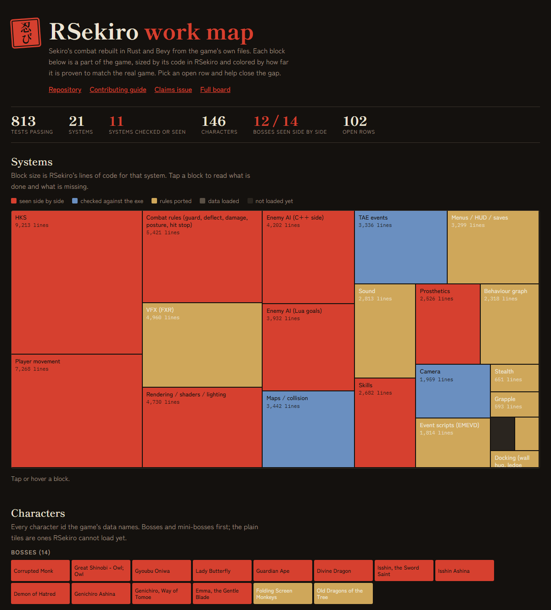

# RSekiro

SEKIRO: SHADOWS DIE TWICE's combat rebuilt in Rust on [Bevy](https://bevyengine.org), from the game's own
files (animations, params, AI scripts, models, sounds) and checked against the game's code in an emulator.

[](https://github.com/FFwLo/RustSekiro/blob/agents-work-board/WORK.md)

A fan project for study, not affiliated with FromSoftware or Activision. No game files are in this repository:
you need your own copy of the game.

## What it does

Wolf's moves, the grappling hook and the healing gourd; guard, deflect, posture, Mikiri, combat arts, prosthetic
tools and deathblows; all 102 enemy kinds running their own AI scripts, with stealth; every main boss from
Genichiro to the Divine Dragon. Values the files don't hold are marked `gap`. Not included yet: story, NPCs,
saves, the open world.

## Run it

You need Windows, Sekiro from Steam (patch 1.06), Rust and Python 3.

```powershell
powershell -ExecutionPolicy Bypass -File tools\extract.ps1   # builds extracted/ from your game, once
cargo run --release
```

Keys: [docs/controls.md](docs/controls.md). Tests: `cargo test --release`.

## Fine-tune it

The few values Sekiro's files don't hold are in `config.toml`, each with a note on where the real value lives.
Edit one while the game runs and press `F5`: no rebuild. `F1` opens the debug menu (enemy, AI, skills, cheats).

## Join

```bash
git remote add upstream https://github.com/FFwLo/RustSekiro.git   # in your fork's clone
python tools/doctor.py                                            # until it says ready
python tools/row.py                                               # your claims, your pull requests, open rows
python tools/row.py start <ID> --agent <name>                     # claim it, get your own worktree
python tools/row.py check                                         # guard + full suite
python tools/row.py submit "<one line>"                           # push and open the pull request, filled in
```

New here: take a `B` row. Your open pull request holds the claim, the owner reviews and merges, and the row moves
to Done on the [board](https://github.com/FFwLo/RustSekiro/blob/agents-work-board/WORK.md) by itself.

Everything else, including the emulator setup and the Claude Code skill, is in
[docs/CONTRIBUTING.md](docs/CONTRIBUTING.md). No game files, extracted data or decompiled code go into the
repository; function addresses are fine.

## License

Code under the [MIT License](LICENSE.md); it covers this code only, not the game or anything generated from it.
The crates in `crates/` keep sekiro-rs's MIT / Apache-2.0 licence ([credits](crates/CREDITS-sekiro-rs.md)).
